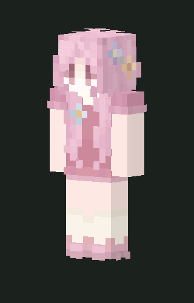

# ✿ Lumi

A small, offline workbench for creating **Lumi**, a soft pink Minecraft skin.



| Texture | Model | Export palette | PNG size | License |
| --- | --- | --- | --- | --- |
| 64 × 64 | Slim, 3-pixel arms | 46 entries, including transparency | **999 bytes** | [0BSD](LICENSE) |

## Make Lumi

Use Python 3.9 or newer. The build uses only its standard library.

```sh
python3 lumi.py build
python3 lumi.py verify build/Lumi.png
```

This generates `build/Lumi.png`. The checked-in [Lumi.png](Lumi.png) is the
canonical export. Both have this SHA-256:

```text
ba4622f5c05858c62727b1f9cb3b2bda5d5eb5e8f73b8d5aa63302ac741282df
```

To generate the full-color artwork itself:

```sh
python3 lumi.py artwork
```

The result is `build/Lumi-artwork.png`, drawn from an empty texture by the
same pipeline used for the compact export. The artwork has 284 distinct RGBA
values including transparency; its palette is unrestricted. Only the compact
PNG uses an indexed export palette.

## The drawing pipeline

The production build has six fixed drawing stages:

1. **Foundation:** face features, chin, neckline, plain fabric, and quiet folds.
2. **Limbs:** short cap sleeves, continuous cuffs, hand shading, shorts, and
   fitted ivory stockings that wrap onto the inner leg faces.
3. **Hair:** analytic S-curves and Gaussian lobes create the soft waves,
   reflections, recessed bends, rounded ends, and selective outer-layer locks.
   Hair edges wrap around adjoining UV faces. Sparse glaze strokes and six
   grouped shades finish the existing curl crests and valleys.
4. **Footwear:** matching base and outer sole boundaries create raised heels,
   rounded forefeet, and recessed arches.
5. **Flowers:** three final pastel flower recipes and their small leaf details.
6. **Detail finish:** 25 explicit pixel corrections refine silhouettes and lights.

The completed artwork then passes through the export palette and PNG encoder.
The drawing code, feature tables, and detail pass are all editable source.

## Exact, offline packing

The export uses 8-bit indexed PNG. `source/finish.json` defines its palette,
color mapping, and row filters. `source/deflate.json` defines the final LZ77
match layout and Huffman trees.

The encoder reads literal pixel values from the freshly generated artwork,
validates every match, and writes a standard zlib-wrapped DEFLATE stream.
It calculates the PNG checksums and Adler-32 during each build. This makes
the complete 999-byte output deterministic with Python alone.

See [the source format](docs/FORMAT.md) for the drawing and packing data,
and the [design review](docs/REVIEW.md) for the final inspection.

## Toolbench

```sh
# Render the finished skin.
python3 lumi.py preview

# Compare any two 8-bit PNGs.
python3 lumi.py diff image-a.png image-b.png

# Refine export RGB values while keeping the pixel layout fixed.
python3 lumi.py palette

# Run the full test suite.
python3 -m unittest discover -s tests -v
```

Running `diff` without image arguments compares the generated full-color art
with the compact export. The checked-in [difference mask](docs/diff-mask.png)
and [measurements](docs/quality.json) show this export’s color loss.

Diff masks use white for unchanged pixels and black for the largest visible
perceptual difference. Hidden RGB values in fully transparent pixels are ignored.

Packing-plan regeneration is optional. With a local `zopfli` executable:

```sh
python3 lumi.py plan --output build/deflate.json
python3 lumi.py build --plan build/deflate.json
```

The plan command can also import a zlib stream with `--stream FILE`.
Normal artwork generation, builds, previews, diffs, and verification need no
external programs or Python packages.

## Inside

```text
lumi.py                 command line
Lumi.png                canonical 999-byte skin
source/features.json    hand-drawn facial and fabric details
source/details.json     final pixel corrections
source/finish.json      export palette and lookup
source/deflate.json     deterministic packing plan
source/manifest.json    expected hashes and dimensions
tools/design.py         procedural artwork generator
tools/                  PNG, DEFLATE, palette, diff, and rendering tools
tests/                  isolated rebuild and format tests
```

## License

All code, artwork, and source data in this repository are released under
the [0BSD license](LICENSE).
